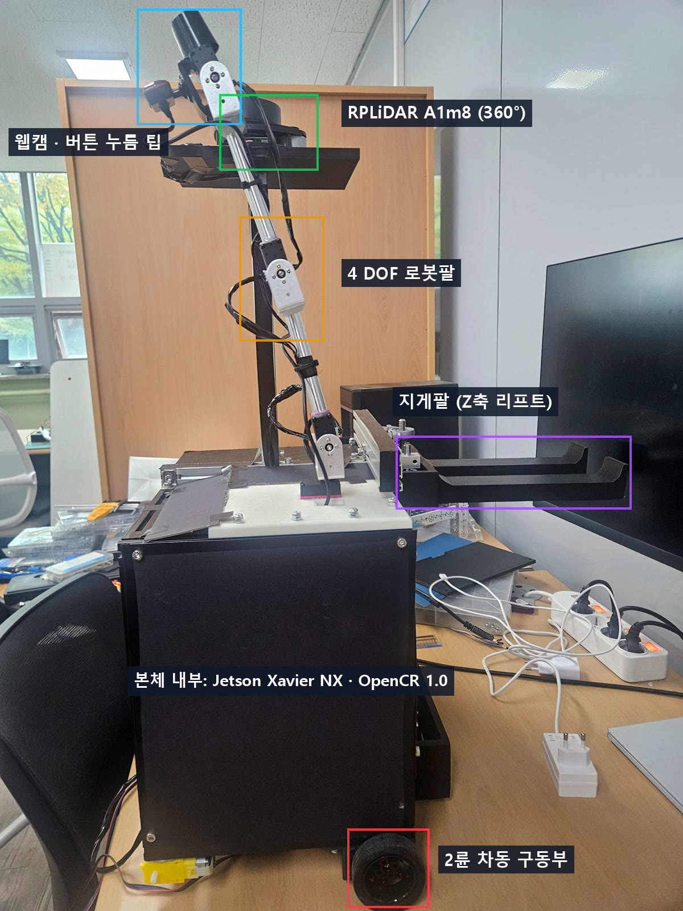
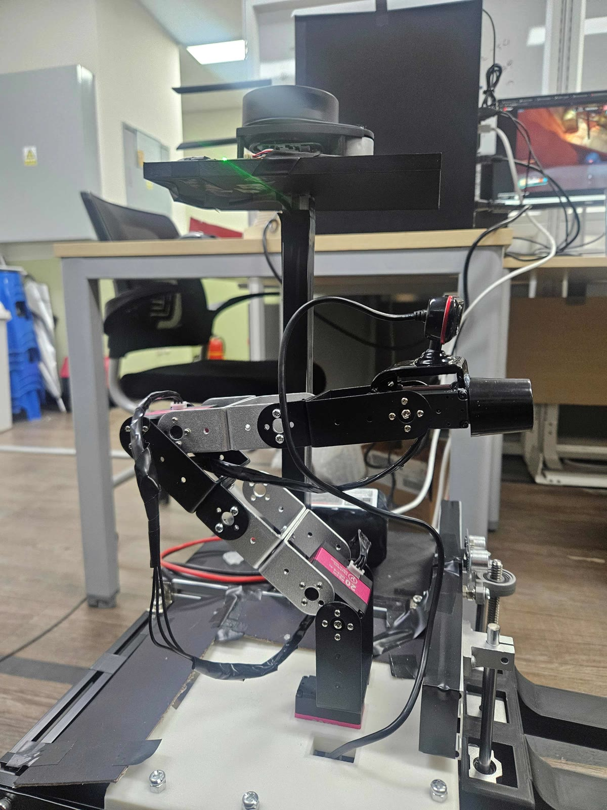
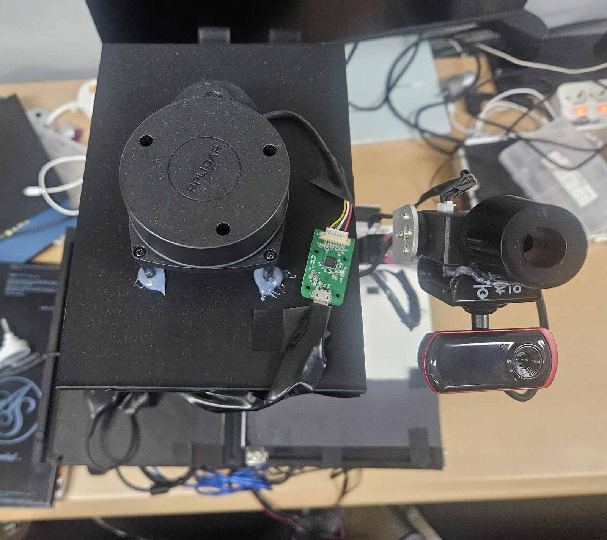
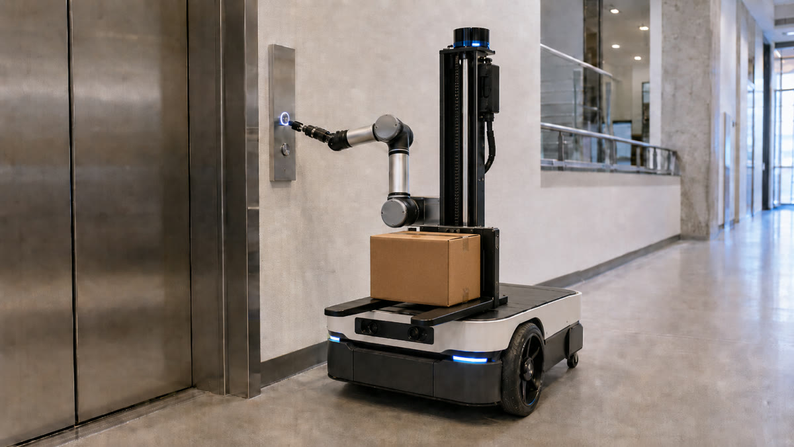
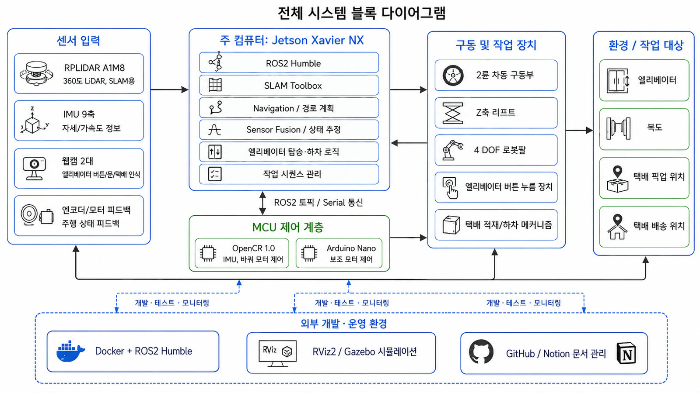

# PackagU

**엘리베이터 버튼을 로봇팔로 직접 눌러 층을 이동하는 실내 자율 택배 배달 로봇**  
건국대학교 전기전자공학부 2026 종합설계 **5조**

[시연](#시연) · [시스템 구조](#시스템-구조) · [코드 읽기 지도](#핵심-구현과-코드-읽기-지도) · [검증 결과](#검증-결과와-한계) · [개발 과정](docs/development_log.md) · [팀과 역할](#팀과-역할)

<!-- VIDEO_SLOT: hero_gif (추후 대표 실물 동작 GIF로 교체) -->
<p align="center">
  
</p>
<p align="center"><sub>실물 로봇 측면 및 주요 하드웨어 구성 (2026-10 촬영, 라벨 표시)</sub></p>

---

## 한눈에 보기

| 항목 | 내용 |
|---|---|
| **해결 문제** | 건물 엘리베이터 API 연동이나 제어반 개조 없이, 기존 다층 건물에서 로봇이 스스로 층을 오가며 택배를 배달 |
| **핵심 방식** | 2륜 차동 SLAM/Nav2 주행 + **4 DOF 로봇팔·웹캠 직접 버튼 조작** + **층별 자동 지도 전환** + **Z축 지게팔 상하차** |
| **주요 환경** | NVIDIA Jetson Xavier NX (Docker · ROS 2 Humble), OpenCR 1.0, RPLiDAR A1m8, Arduino Uno + TB6600, Python / C++ |
| **주요 결과** | 가상 건물 왕복 시뮬 `10/10` · Jetson 분산 E2E `3/3` · 실측 지도 사전시험 `19/19` & 층 전환 AMCL `12/12` · 신공학관 실물 복도 Nav2 부분 성공(`2/5`) · 강의실 v3 시뮬 `4,112`회 분석 ([상세](docs/results.md)) |
| **코드 기준** | `Final_Demo@db73e09` (`2026-11-04 09:51 KST`)에서 최종 시연 핵심 코드만 선별 정리 (공개 이관 시 정적 구문·안전 검사 수행, Docker/실기 재구동 미실행) |

---

## 해결하려던 문제

기존 실내 배달 로봇은 엘리베이터 제조사의 전용 통신 API나 건물 내 중계 모듈을 설치해야 층간 이동이 가능하다. **PackagU**는 기존 건물 인프라를 전혀 수정하지 않고도 다층 배달을 수행할 수 있도록 다음 4가지를 하나의 자율 스택으로 통합했다.

1. **직접 버튼 조작**: 팔 끝 웹캠으로 호출·층 버튼을 인식하고 4 DOF 로봇팔로 물리 버튼을 직접 누른 뒤 램프 점등을 확인
2. **층별 지도 자동 전환**: 엘리베이터 이동 뒤 `/map_server/load_map`과 `/initialpose`로 목적층 지도를 교체하고 AMCL·costmap 반영을 확인한 뒤 주행 재개
3. **지게팔 택배 상하차**: TB6600 + Arduino Uno 기반 Z축 지게팔(`lift_uno`)과 상승 중 초음파 높이 제한(`10 cm`)으로 팔레트·택배를 들어 운반
4. **이중 구동 안전 게이트**: Nav2 `/cmd_vel`을 `nav_safety_gate`와 OpenCR 펌웨어 워치독(`0.5 s`, 속도 상한 `48 rpm`)으로 이중 보호

---

## 시연

### 실물 E2E · 시뮬레이션 영상 슬롯

<!-- VIDEO_SLOT: clip_pickup (택배 적재 클립 추후 첨부) -->
<!-- VIDEO_SLOT: clip_call (엘리베이터 호출·버튼 조작 클립 추후 첨부) -->
<!-- VIDEO_SLOT: clip_press (캐빈 내부 층 버튼·층수 확인 클립 추후 첨부) -->
<!-- VIDEO_SLOT: clip_unload_return (목적층 하차·배달·복귀 클립 추후 첨부) -->
<!-- VIDEO_SLOT: clip_sim (Gazebo 실측 지도 E2E 시뮬레이션 클립 추후 첨부) -->

| 구간 | 장면 | 상태 |
|---|---|---|
| 1. 택배 적재 | F1 보관 구역 이동 → 팔레트 진입 → 지게팔 상승 | *영상 클립 추후 첨부 예정* |
| 2. 엘리베이터 호출 · 탑승 | 호출 버튼(▲) 인식·누르기 → 탑승 | *영상 클립 추후 첨부 예정* |
| 3. 목적층 이동 · 지도 전환 | 캐빈 층 버튼 누르기 → 층수 확인 → F2 지도 전환 | *영상 클립 추후 첨부 예정* |
| 4. 배달 · 복귀 | 목적지 하차 → 복귀 호출(▼) → F1 출발점 복귀 | *영상 클립 추후 첨부 예정* |
| 5. Gazebo 시뮬레이션 | 신공학관 실측 지도 기반 왕복 E2E 시뮬레이션 | *영상 클립 추후 첨부 예정* |

### 실물 하드웨어 및 설계 그림

| 4 DOF 로봇팔 · 팔 끝 웹캠 (실물) | RPLiDAR A1m8 · 버튼 누름 팁 (실물) | 외형 콘셉트 (설계 그림) |
|---|---|---|
|  |  |  |

---

## 시스템 구조


<p align="center">
  
</p>
<p align="center"><sub>전체 시스템 블록 다이어그램 (초기 설계 그림 · 최신 세부 구조는 <a href="docs/architecture.md">docs/architecture.md</a> 참조)</sub></p>

---

## 핵심 구현과 코드 읽기 지도

코드를 처음 살펴볼 때 기능별 핵심 진입 파일은 아래 순서대로 확인하면 전체 동작 흐름을 파악할 수 있다.

| 영역 | 경로 | 핵심 파일 및 구현 내용 |
|---|---|---|
| **구동 안전 · 시리얼 브리지** | [`src/drive_pkg/`](src/drive_pkg/) | `opencr_protocol.py`(시리얼 규약), `opencr_bridge.py`(엔코더 odom·속도 제한), `nav_safety_gate.py`(`/scan`·`/odom` 신선도 감시) |
| **SLAM · Nav2 · 실측 지도** | [`src/slam_pkg/`](src/slam_pkg/) | `launch/field_base.launch.py`, `kku_navigation.launch.py`, `config/nav2_params.yaml`, `maps/field/`(신공학관 F1·F2 지도·웨이포인트) |
| **4 DOF 로봇팔 제어** | [`src/robot_arm_pkg/`](src/robot_arm_pkg/) | `servo_protocol.py`(티칭 PWM 시퀀스), `arm_execution.py`, `arm_sequence_node.py`, `config/camera_views.json` |
| **미션 · 층별 자동 지도 전환** | [`integration/`](integration/elevator_auto_map_switch/README.md) | `elevator_mission`(Behavior Tree 미션), `elevator_auto_map_switch`(`/map_server/load_map`·AMCL 재정위), `gazebo_world_swap`(시뮬 월드 교체) |
| **비전 · 자율 스킬 앱** | [`apps/`](apps/button_arm_test/README.md) | `button_arm_test/`(버튼 인식·누르기 웹/API), `floor_reader/`(층수 판독), `pickup_real/`(팔레트·택배 인식 및 집기), `jetson_skill_tests/`(현장·시뮬 공용 상태머신) |
| **MCU 펌웨어** | [`firmware/`](firmware/lift_uno/README.md) | `opencr/`(2륜 차동·0.5 s 워치독), `opencr_imu/`(IMU 9축 확장), `lift_uno/lift_uno.ino`(TB6600 지게팔·초음파 `10 cm` 정지) |
| **현장 E2E 진행기 · 테스트** | [`scripts/`](scripts/field_video_rehearsal.py) | `fieldctl`(현장 통합 CLI), `field_video_rehearsal.py` & `field_video/`(26단계 E2E 진행기), `check_portability.py`, 오프라인 계약 테스트 51종 |
| **실측 지도 시뮬레이션 (열람용)** | [`sim/real_maps/`](sim/real_maps/README.md) | `sim_stack.py`, `run_e2e.py`, `opencr_shim.py`, `pickup/`, `results/20261008_summary.md` *(코드 구조·과거 결과 참고용)* |

---

## 검증 결과와 한계

실물 검증과 시뮬레이션 검증을 분리해 기록한다. 세부 조건·근거 파일·알려진 한계는 [docs/results.md](docs/results.md)에 정리되어 있다.

| 대상 | 환경 · 날짜 | 주요 결과 | 판정 |
|---|---|---|---|
| 신공학관 복도 Nav2 (실물) | Jetson + RPLiDAR + OpenCR, 신공학관 F1·F2 (`2026-09-16`) | 5회 goal 중 `2/5 SUCCEEDED`(F2 배달 `244.1 s`, F1 복귀 `119.2 s`), `3/5 FAILED` | **실물 검증** (부분 성공) |
| 지게팔 `lift_uno` 펌웨어 대조 | Jetson 연결 Arduino Uno 실물 보드 (`2026-10-29`) | 부팅 배너·출력 문자열·펄스(`10/302 µs`, `12,800`펄스) 소스 일치 확인 | **실물 검증** (보드 대조) |
| 가상 건물 왕복 · Jetson 분산 E2E | Gazebo + 보행자 5 + 정적 장애물 2 + 분산 LAN (`2026-08-21`) | 데스크톱 `10/10 PASS`, Jetson 분산 `3/3 PASS` (RAM 피크 `2.5 GB/6.8 GB`) | **시뮬레이션 검증** |
| 신공학관 실측 지도 E2E (V5) | 격리 컨테이너 Gazebo + 인코더 odom (`2026-10-08`) | 사전시험 `19/19`, 캐빈 direct E2E `4/4` 완주, 전구간 nav2 `1/3`, 층 전환 AMCL `12/12` 수렴 | **시뮬레이션 검증** |
| 독립 자동 택배 집기 (ArUco 지그) | 격리 컨테이너 Gazebo + 몸체 카메라·초음파 (`2026-10-29`) | 4개 스위트 총 `18/18` 통과 (기하 판정 기반, 접촉·하중 물리 미검증) | **시뮬레이션 검증** |
| 강의실 v3 배치도 시뮬레이션 | 격리 컨테이너 Gazebo + 레이캐스트 `4,112`회 (`2026-11-04`) | 일반 Gazebo `12/12`, 적재 거친 조건 `7/9`, 라이다 가림 경계 폭 `31~32 cm`, 고정 복귀 제안 `300/300` | **시뮬레이션 검증** |
| 공개 레포 이관 정적 검사 | 호스트 Python 3.12 (`2026-11-19`) | `.py` `264`개 `py_compile` 오류 `0`, 커밋 트리·전체 이력 감사 `FAIL 0` *(Docker·실기 미재실행)* | **오프라인 검증** |

---

## 저장소 구조 및 문서

```text
PackagU/
├─ README.md · LICENSE · .gitattributes · .gitignore
├─ docs/               architecture.md · results.md · development_log.md · how_to_run.md · hardware_spec.md · deployment/ · media/
├─ src/                ROS 2 루트 워크스페이스 (common_pkg · slam_pkg · drive_pkg · robot_arm_pkg)
├─ integration/        ROS 2 통합 overlay 3개 (elevator_mission · elevator_auto_map_switch · gazebo_world_swap + COLCON_IGNORE)
├─ apps/               비전·로봇팔·층수·택배 자율 앱 (button_arm_test · floor_reader · pickup_real · jetson_skill_tests)
├─ firmware/           OpenCR 구동·IMU · Arduino Uno 지게팔(lift_uno) 펌웨어
├─ scripts/            현장 실행기(fieldctl, field_video_rehearsal.py) · 계약/단위 테스트 · 배포 도구
├─ sim/real_maps/      신공학관 실측 지도 Gazebo 시뮬레이션 코드와 결과 요약 (열람·결과 참고용)
└─ docker/             개발 PC(amd64)·Jetson(aarch64) Dockerfile 및 Compose 설정
```

- 시스템 구조와 코드 안내: [docs/architecture.md](docs/architecture.md)
- 하드웨어 기준 사양: [docs/hardware_spec.md](docs/hardware_spec.md)
- 검증 결과와 한계: [docs/results.md](docs/results.md)
- 개발 타임라인: [docs/development_log.md](docs/development_log.md)
- 환경·빌드 참고 안내: [docs/how_to_run.md](docs/how_to_run.md)

---

## 팀과 역할

**건국대학교 전기전자공학부 2026 종합설계 5조**

| 이름 | GitHub | 담당 역할 |
|---|---|---|
| **이준형** | [@JunhyungLee25](https://github.com/JunhyungLee25) | SLAM · Nav2 · 층별 자동 지도 전환 · 시뮬레이션 · 현장 시스템 통합 |
| **한수민** | [@inonewater](https://github.com/inonewater) | Fusion 360 기구 설계 · 2륜 차동 구동부 · Z축 지게팔(리프트) |
| **이성덕** | [@DuckFrog123](https://github.com/DuckFrog123) | 4 DOF 로봇팔 · 엘리베이터 버튼 인식 및 조작 |

## 라이선스

[MIT License](LICENSE) — Copyright (c) 2026 PackagU
