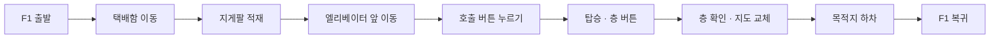

# PackagU

엘리베이터 버튼을 로봇팔로 직접 눌러 층을 이동하는 실내 택배 배달 로봇입니다.  
건국대학교 전기전자공학부 2026 종합설계 5조에서 제작했습니다.

<!-- VIDEO_SLOT: hero_gif -->
<p align="center">
  
</p>

## 개요

기존 실내 배달 로봇은 건물 엘리베이터 제어반에 통신 모듈을 달거나 제조사 API를 연동해야 층간 이동이 가능합니다. PackagU는 건물 설비를 건드리지 않고, 팔 끝에 달린 웹캠으로 버튼을 찾아 4 DOF 서보 로봇팔로 직접 누르는 방식을 택했습니다.

주행은 Jetson Xavier NX 위 Docker(ROS 2 Humble) 환경에서 RPLiDAR A1m8과 OpenCR 1.0으로 처리하고, 택배 상하차는 Arduino Uno + TB6600 기반 Z축 지게팔을 사용합니다. 층을 옮긴 뒤에는 `/map_server/load_map`으로 지도를 바꾸고 AMCL을 다시 맞춰 주행을 이어갑니다.

기준 코드: `Final_Demo` 브랜치 `db73e09` (2026-11-04)

## 시연

<!-- VIDEO_SLOT: clip_pickup -->
<!-- VIDEO_SLOT: clip_call -->
<!-- VIDEO_SLOT: clip_press -->
<!-- VIDEO_SLOT: clip_unload_return -->
<!-- VIDEO_SLOT: clip_sim -->

*(시연 영상 클립은 추후 추가 예정)*

| 4 DOF 로봇팔 · 웹캠 | RPLiDAR A1m8 · 버튼 팁 | 초기 외형 예상도 |
|---|---|---|
|  |  |  |

## 동작 흐름 및 시스템 구성



<p align="center">
  
</p>

자세한 노드 연결과 하드웨어 사양은 [docs/architecture.md](docs/architecture.md), [docs/hardware_spec.md](docs/hardware_spec.md)에 정리해 두었습니다.

## 폴더 구성

```text
PackagU/
├─ src/            ROS 2 기본 패키지 (common_pkg, slam_pkg, drive_pkg, robot_arm_pkg)
├─ integration/    미션 상태머신, 층별 지도 전환, Gazebo 월드 교체 overlay (COLCON_IGNORE 포함)
├─ apps/           버튼 인식·조작, 층수 판독, 팔레트 집기, 자율 스킬 상태머신
├─ firmware/       OpenCR 구동/IMU 펌웨어, Arduino Uno 지게팔(lift_uno) 펌웨어
├─ scripts/        현장 운영 CLI(fieldctl), E2E 리허설 진행기, 단위/계약 테스트
├─ sim/real_maps/  신공학관 실측 지도 기반 Gazebo 시뮬레이션 코드와 결과 기록
├─ docker/         PC(amd64) · Jetson(aarch64) Dockerfile 및 Compose
└─ docs/           구조, 결과, 개발 일지, 현장 배포 문서
```

주요 코드 위치:
- 구동 브리지 및 안전 정지: `src/drive_pkg/drive_pkg/` (`opencr_bridge.py`, `nav_safety_gate.py`)
- SLAM · Nav2 설정 및 실측 지도: `src/slam_pkg/config/nav2_params.yaml`, `src/slam_pkg/maps/field/`
- 로봇팔 서보 시퀀스: `src/robot_arm_pkg/robot_arm_pkg/` (`servo_protocol.py`, `arm_sequence_node.py`)
- 층별 지도 자동 전환: `integration/elevator_auto_map_switch/src/auto_floor_orchestrator_pkg/`
- 버튼 · 층수 · 택배 인식: `apps/button_arm_test/app.py`, `apps/floor_reader/app.py`, `apps/pickup_real/pickup_real.py`
- 현장 26단계 E2E 진행기: `scripts/field_video_rehearsal.py`, `scripts/fieldctl`
- 펌웨어: `firmware/opencr/opencr_drive_bridge.ino`, `firmware/lift_uno/lift_uno.ino`

## 검증 결과

실물 시험과 Gazebo 시뮬레이션 결과를 나눠 적습니다. 상세 표와 한계는 [docs/results.md](docs/results.md)에 있습니다.

| 구분 | 항목 | 환경 · 날짜 | 결과 |
|---|---|---|---|
| 실물 | 신공학관 복도 Nav2 주행 | Jetson + RPLiDAR + OpenCR (2026-09-16) | 5회 중 2회 도착(F2 배달 244.1 s, F1 복귀 119.2 s), 3회 실패 |
| 실물 | 지게팔 `lift_uno` 보드 대조 | Arduino Uno 실물 보드 (2026-10-29) | 부팅 배너·초음파 10 cm 정지·펄스(10/302 µs, 12,800회) 일치 |
| 시뮬 | 가상 건물 왕복 · 분산 부하 | Gazebo + 보행자 5 + 장애물 2 (2026-08-21) | PC 10/10 통과, Jetson 분산 3/3 통과 (RAM 피크 2.5 / 6.8 GB) |
| 시뮬 | 신공학관 실측 지도 E2E | 격리 Gazebo + 인코더 odom (2026-10-08) | 사전시험 19/19, 캐빈 direct 4/4 완주, nav2 1/3, 층 전환 AMCL 12/12 수렴 |
| 시뮬 | 독립 자동 택배 집기 | ArUco 지그 + 몸체 카메라 (2026-10-29) | 4개 스위트 18/18 통과 (기하 attach 기준) |
| 시뮬 | 강의실 v3 배치도 반복 | Gazebo + 레이캐스트 4,112회 (2026-11-04) | 일반 12/12, 적재 거친 조건 7/9, 짐 폭 라이다 가림 경계 31~32 cm |

## 문서

- [시스템 구성](docs/architecture.md)
- [하드웨어 사양](docs/hardware_spec.md)
- [실험 및 검증 결과](docs/results.md)
- [개발 타임라인](docs/development_log.md)
- [빌드 및 실행 참고](docs/how_to_run.md)

## 팀원

건국대학교 전기전자공학부 2026 종합설계 5조

| 이름 | GitHub | 담당 |
|---|---|---|
| 이준형 | [@JunhyungLee25](https://github.com/JunhyungLee25) | SLAM, Nav2, 층별 지도 전환, 시뮬레이션, 시스템 통합 |
| 한수민 | [@inonewater](https://github.com/inonewater) | 기구 설계(Fusion 360), 구동부, Z축 지게팔 |
| 이성덕 | [@DuckFrog123](https://github.com/DuckFrog123) | 4 DOF 로봇팔, 버튼 인식 및 조작 |

## 라이선스

[MIT License](LICENSE) — Copyright (c) 2026 PackagU
