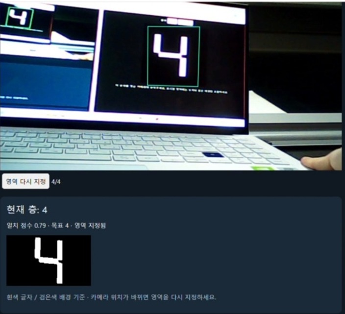

# PackagU

엘리베이터 버튼을 4 DOF 로봇팔로 직접 눌러 층을 옮기는 실내 택배 배달 로봇이다. 건국대학교 전기전자공학부 2026 종합설계 5조가 만들었다.

ROS 2 Humble, Nav2, SLAM Toolbox, OpenCR 1.0, Jetson Xavier NX, Arduino Uno.

[팀과 역할](#팀과-역할) · [시스템 아키텍처](#시스템-아키텍처) · [핵심 기술 과제와 판단](#핵심-기술-과제와-판단) · [동작 흐름과 시연](#동작-흐름과-시연) · [피드백 반영 개선](#피드백-반영-개선) · [검증 결과와 한계](#검증-결과와-한계)

  
  

왼쪽: 실물 주행 · 버튼 조작 · 배달 시연 (20초 하이라이트) · 오른쪽: 실물 로봇 부품 구성 (2026-10 촬영)

## 프로젝트 요약

| 항목 | 내용 |
|---|---|
| 문제 | 엘리베이터 API가 없는 기존 건물에서 층간 무인 택배 배달 수행 |
| 접근 방식 | 2륜 차동 SLAM/Nav2 주행, 팔 끝 웹캠 버튼 · 층수 인식, 4 DOF 팔 직접 조작, Z축 지게팔 상하차 |
| 핵심 환경 | Jetson Xavier NX(Docker · ROS 2 Humble), OpenCR 1.0, RPLiDAR A1m8, Arduino Uno + TB6600 |
| 확인한 결과 | 실물 주행 · 엘리베이터 버튼 조작 · 배달 시연 하이라이트 확보, 신공학관 복도 실물 Nav2 2/5, 가상 왕복 시뮬 10/10, Jetson 분산 시뮬 3/3, 실측 지도 E2E 시뮬 direct 4/4, 강의실 v3 시뮬 4,112회 분석 |
| 코드 기준 | `Final_Demo@db73e09` (2026-11-04). 공개 정리 시 Python 구문 검사와 정적 안전 감사를 마쳤고 Docker와 실기 재구동은 수행하지 않았다 |

## 해결하려던 문제

건물 엘리베이터 대부분에는 외부 로봇이 층을 호출할 통신 API가 없다. 승강기 제어반을 개조해 중계 보드를 붙이기도 현실적으로 어렵다.

5조는 건물 설비를 손대지 않는 구조를 택했다. 로봇이 팔 끝 웹캠으로 호출 버튼과 층 버튼을 찾는다. 이어서 4 DOF 서보 팔이 물리 버튼을 직접 누른다. 층 이동이 끝나면 Nav2 지도를 목적층 지도로 바꾸고 AMCL을 다시 맞춘 뒤 배달 지점까지 주행한다.

## 팀과 역할

| 이름 | GitHub | 담당 영역 | 관련 경로 |
|---|---|---|---|
| 이준형 | [@JunhyungLee25](https://github.com/JunhyungLee25) | SLAM, Nav2, 층별 자동 지도 전환, Gazebo 시뮬레이션, 현장 통합 | [`src/slam_pkg/`](src/slam_pkg/), [`integration/`](integration/elevator_auto_map_switch/README.md), [`sim/real_maps/`](sim/real_maps/README.md), [`scripts/`](scripts/fieldctl) |
| 한수민 | [@inonewater](https://github.com/inonewater) | Fusion 360 기구 설계, 2륜 차동 구동부, Z축 지게팔(리프트) | [`src/common_pkg/`](src/common_pkg/), [`src/drive_pkg/`](src/drive_pkg/), [`firmware/`](firmware/lift_uno/README.md) |
| 이성덕 | [@DuckFrog123](https://github.com/DuckFrog123) | 4 DOF 로봇팔, 엘리베이터 버튼 인식 및 누르기 제어 | [`src/robot_arm_pkg/`](src/robot_arm_pkg/), [`apps/button_arm_test/`](apps/button_arm_test/README.md) |

## 시스템 아키텍처

Jetson Xavier NX가 ROS 2 Humble 컨테이너 안에서 주행과 상태 전이를 맡는다. OpenCR 1.0은 바퀴 모터와 9축 IMU를 제어하고 Arduino Uno는 TB6600 스테퍼 드라이버로 지게팔을 올리고 내린다.

  

초기 설계 그림. 현재 노드 연결과 토픽 흐름은 <a href="docs/architecture.md">docs/architecture.md</a>에 적었다.

## 핵심 기술 과제와 판단

### 구동 명령 안전 차단

Nav2가 내는 `/cmd_vel`을 모터로 바로 보내면 센서 지연이나 통신 끊김 시 로봇이 계속 움직인다. `nav_safety_gate` 노드를 중간에 두어 `/scan`과 `/odom` 주기가 끊기면 `/cmd_vel_safe`를 0으로 자른다. OpenCR 펌웨어에서도 0.5 s 명령 타임아웃과 48 rpm 속도 상한을 따로 걸었다([`src/drive_pkg/`](src/drive_pkg/), [`firmware/opencr/`](firmware/opencr/), [`docs/deployment/02_opencr_serial_protocol.md`](docs/deployment/02_opencr_serial_protocol.md)).

### 엘리베이터 버튼 직접 조작

승강기마다 버튼 높이와 간격이 다르다. 팔 끝 웹캠으로 버튼판과 점등 램프를 보고 티칭된 PWM 시퀀스(`servo_protocol.py`)로 누르는 구조를 썼다. 웹 서버와 API(`apps/button_arm_test/`)가 인식 안정 여부를 확인한 뒤 팔 명령을 보낸다. 실물 버튼 접촉 여부는 램프 점등과 운영자 확인에 의존하는 한계가 남았다.

### 층 전환 뒤 이전 지도 잔존 방지

엘리베이터에서 내린 직후 `/map_server/load_map`과 `/initialpose`만 호출하면 이전 층 costmap이 잠시 남아 경로 계획이 꼬인다. 현장 진행기(`scripts/field_video/ros_map_switch.py`)와 오케스트레이터(`integration/elevator_auto_map_switch/`)는 새 지도의 크기와 원점, costmap 벽 칸 일치 여부를 확인한 뒤에만 다음 Nav2 goal을 보낸다.

### 루트 패키지와 통합 overlay 분리

실기 배포 패키지 4개(`src/`)와 시뮬레이션·미션 overlay 3개(`integration/`)를 한 워크스페이스에서 같이 빌드하면 ament index 충돌이 났다. `integration/`을 루트 바깥에 두고 `integration/COLCON_IGNORE`를 넣어 루트 `colcon build`가 overlay를 흡수하지 못하게 막았다.

## 동작 흐름과 시연

현장 E2E 진행기(`scripts/field_video_rehearsal.py`)는 F1 출발부터 택배 적재, 호출 버튼 조작, 층 전환, 하차, F1 복귀까지 26단계를 한 터미널에서 순서대로 밟는다. 상단 시연 GIF(`docs/media/e2e_demo.gif`)에는 실물 로봇이 1층 복도에서 택배를 적재하고 승강장 호출 버튼과 엘리베이터 내부 4번 버튼을 웹캠으로 인식해 직접 누른 뒤 목적층에 배달하는 구간을 20초로 담았다.

| 4 DOF 로봇팔 · 팔 끝 웹캠 (실물 사진) | RPLiDAR A1m8 · 버튼 누름 팁 (실물 사진) | 외형 콘셉트 (설계 그림) |
|---|---|---|
|  |  |  |

## 피드백 반영 개선

시연 피드백에서 나온 두 가지 문제를 하드웨어 설정과 제어 흐름에 반영했다.

### 1. 적재 높이 제한 (로봇팔 간섭 방지)

지게팔을 기존 최대 높이(500 mm)까지 올리면 택배 상단이 로봇팔 동작 영역까지 올라와 팔 전개와 웹캠 시야를 가렸다. 정면 초음파 센서(`firmware/lift_uno/lift_uno.ino`)가 상승 중 320펄스마다 거리를 재서 10 cm 미만이면 즉시 멈추게 했다. 지게팔 상승 높이도 85 mm 수준으로 낮춰 택배가 로봇팔 아래에 머물게 조정했다.

  

### 2. 층수 표시기 확인 후 엘리베이터 하차

엘리베이터 문이 열리면 바로 내리는 방식에서는 중간층 정차 시 잘못 내릴 수 있다. 탑승 직후 로봇팔을 주행 자세(`front_view`)에서 층수 확인 자세(`floor_view`: J0 1500 · J1 1480 · J2 1670 µs, [`camera_views.json`](src/robot_arm_pkg/config/camera_views.json))로 전환한다. 팔 끝 웹캠 영상에서 Otsu 이진화와 7-segment 템플릿 IoU 매칭([`apps/floor_reader/`](apps/floor_reader/README.md))으로 현재 층을 읽고 목표층과 일치할 때만 하차 조건을 연다.

  

  

층수 인식기 테스트 화면 (목표 4층, 일치 점수 0.79)

## 검증 결과와 한계

실물 시험과 시뮬레이션 기록을 분리해 적는다. 과거 개발 저장소(`Final_Demo@db73e09`) 기록을 인용한 항목과 이번 공개 정리 시 직접 수행한 검사를 구분했다. 세부 조건과 근거는 [docs/results.md](docs/results.md)에 있다.

| 대상 | 환경 · 날짜 | 결과 | 판정 | 근거 · 한계 |
|---|---|---|---|---|
| 신공학관 실물 배달 시연 | 건물 복도 · 엘리베이터 실물 | 적재 → 호출 버튼 인식 · 누르기 → 탑승 · 4번 버튼 → 목적층 하차 확인 | 실물 검증 (하이라이트) | [`docs/media/e2e_demo.gif`](docs/media/e2e_demo.gif) (20초 편집본). 구간별 자율 · 수동 경계와 복귀 구간은 영상만으로 미확인 |
| 신공학관 복도 Nav2 주행 | Jetson + RPLiDAR + OpenCR, F1 · F2 (2026-09-16) | 5회 중 2회 도착(F2 배달 244.1 s, F1 복귀 119.2 s), 3회 실패 | 실물 검증 | `goal_results.csv` 인용. 보관함과 F2 staging goal 실패 |
| 지게팔 `lift_uno` 보드 대조 | Arduino Uno 실물 보드 (2026-10-29) | 플래시 덤프와 소스 일치(초음파 10 cm 정지, 10/302 µs, 12,800펄스) | 실물 검증 | [09_field_video_rehearsal.md](docs/deployment/09_field_video_rehearsal.md) §11. 진행기 연동 주행은 미실행 |
| 가상 건물 왕복 · 분산 부하 | Gazebo + 보행자 5 + 장애물 2 (2026-08-21) | PC 10/10 통과, Jetson 분산 3/3 통과(RAM 피크 2.5 / 6.8 GB) | 시뮬레이션 검증 | 가상 치수 맵 기준 |
| 신공학관 실측 지도 E2E (V5) | 격리 Gazebo + 인코더 odom (2026-10-08) | 사전시험 19/19, 캐빈 direct 4/4 완주, nav2 1/3, AMCL 재정위 12/12 수렴 | 시뮬레이션 검증 | [`sim/real_maps/results/20261008_summary.md`](sim/real_maps/results/20261008_summary.md). 좁은 문 벽 여유 0.15 m 미달 |
| 독립 자동 택배 집기 | ArUco 지그 + 몸체 카메라 · 초음파 (2026-10-29) | 4개 스위트 18/18 통과 | 시뮬레이션 검증 | [`sim/real_maps/pickup/results/20261029.json`](sim/real_maps/pickup/results/20261029.json). 접촉 · 하중 물리 미검증 |
| 강의실 v3 배치도 반복 | 격리 Gazebo + 레이캐스트 4,112회 (2026-11-04) | 일반 12/12, 적재 거친 조건 7/9, 짐 폭 라이다 가림 경계 31~32 cm | 시뮬레이션 검증 | v3 보고서 인용. 실물 접촉 미검증 |
| 공개 저장소 정적 검사 | 호스트 Python 3.12 (2026-11-19) | `.py` 264개 `py_compile` 오류 0, 커밋 트리 · 이력 감사 FAIL 0 | 오프라인 검증 | Docker 테스트와 `colcon build` 미실행 |

## 저장소 구조

| 경로 | 내용 |
|---|---|
| [`src/`](src/) | ROS 2 루트 패키지 4개(`common_pkg`, `slam_pkg`, `drive_pkg`, `robot_arm_pkg`) |
| [`integration/`](integration/elevator_auto_map_switch/README.md) | 미션 상태머신, 층별 지도 전환, Gazebo 월드 교체 overlay 3개 + `COLCON_IGNORE` |
| [`apps/`](apps/button_arm_test/README.md) | 버튼 인식 웹/API, 층수 판독, 팔레트 집기, 공용 자율 스킬 상태머신 |
| [`firmware/`](firmware/lift_uno/README.md) | OpenCR 구동 · IMU 스케치, Arduino Uno 지게팔(`lift_uno`) 펌웨어 |
| [`scripts/`](scripts/field_video_rehearsal.py) | 현장 CLI(`fieldctl`), 26단계 E2E 진행기, 이식성 · 계약 테스트 51종 |
| [`sim/real_maps/`](sim/real_maps/README.md) | 신공학관 실측 지도 시뮬레이션 코드와 결과 요약(코드 · 결과 열람용) |
| [`docker/`](docker/README.md) | 개발 PC(amd64) · Jetson(aarch64) Dockerfile과 Compose 설정 |
| [`docs/`](docs/architecture.md) | 시스템 구성, 하드웨어 사양, 검증 결과, 개발 타임라인, 현장 배포 문서 |

## 참고 문서와 라이선스

- [시스템 구성 (`docs/architecture.md`)](docs/architecture.md)
- [하드웨어 사양 (`docs/hardware_spec.md`)](docs/hardware_spec.md)
- [검증 결과와 한계 (`docs/results.md`)](docs/results.md)
- [개발 타임라인 (`docs/development_log.md`)](docs/development_log.md)
- [빌드 및 실행 참고 (`docs/how_to_run.md`)](docs/how_to_run.md)

[MIT License](LICENSE) · Copyright (c) 2026 PackagU
