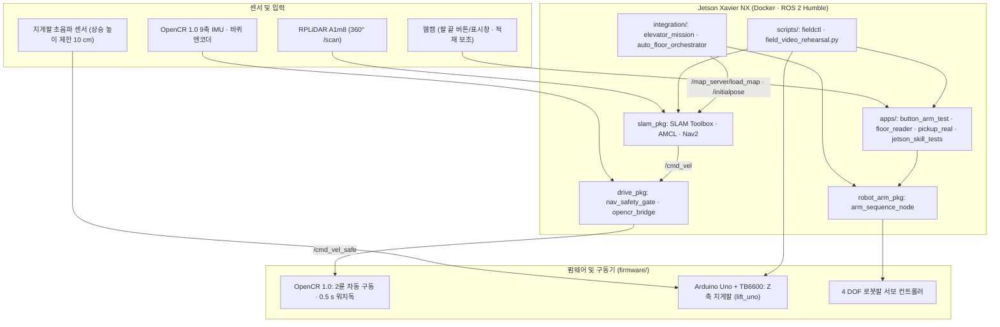

# 시스템 구조 및 코드 읽기 지도

이 문서는 평가자와 코드 분석 도구가 `PackagU`의 하드웨어·소프트웨어 구성과 핵심 진입 파일을 빠르게 파악할 수 있도록 정리한 구조 안내서다. 하드웨어 세부 치수와 실측·임시값 구분은 [hardware_spec.md](hardware_spec.md)를 기준으로 한다.

## 1. 전체 소프트웨어 아키텍처



## 2. 하드웨어 요약


| 구성 요소 | 사양 및 역할 | 관련 코드 |
|---|---|---|
| 주 컴퓨터 | NVIDIA Jetson Xavier NX (JetPack 위 Docker ROS 2 Humble) | [`docker/Dockerfile.jetson`](../docker/Dockerfile.jetson), [`docker/compose/docker-compose.jetson.yml`](../docker/compose/docker-compose.jetson.yml) |
| 주행·IMU MCU | OpenCR 1.0 (2륜 차동, 휠 트랙 `0.51324 m`, 지름 `0.066 m`, 9축 IMU) | [`firmware/opencr/`](../firmware/opencr/), [`firmware/opencr_imu/`](../firmware/opencr_imu/), [`src/drive_pkg/`](../src/drive_pkg/) |
| Z축 지게팔 | TB6600 + Arduino Uno (`u`/`d` 12,800펄스, 상승 중 초음파 `10 cm` 미만 자동 정지) | [`firmware/lift_uno/`](../firmware/lift_uno/), [`scripts/lift_uno_adapter.py`](../scripts/lift_uno_adapter.py) |
| 4 DOF 로봇팔 | 리치 `60 cm` 서보 팔 + 팔 끝 웹캠 (엘리베이터 버튼 직접 조작) | [`src/robot_arm_pkg/`](../src/robot_arm_pkg/), [`apps/button_arm_test/`](../apps/button_arm_test/) |
| LiDAR | RPLiDAR A1m8 (실내 유효 `8 m`, 매핑·AMCL·문 틈 정렬) | [`src/slam_pkg/`](../src/slam_pkg/) |

## 3. 코드 읽기 지도 (어디부터 보면 되는가)

| 관심 영역 | 폴더 | 먼저 볼 핵심 파일 |
|---|---|---|
| **구동 안전·시리얼 브리지** | `src/drive_pkg/` | `drive_pkg/opencr_protocol.py` · `opencr_bridge.py` · `nav_safety_gate.py` |
| **SLAM · Nav2 · 지도** | `src/slam_pkg/` | `launch/field_base.launch.py` · `kku_navigation.launch.py` · `config/nav2_params.yaml` · `maps/field/` |
| **로봇팔 시퀀스 제어** | `src/robot_arm_pkg/` | `robot_arm_pkg/servo_protocol.py` · `arm_execution.py` · `arm_sequence_node.py` · `config/camera_views.json` |
| **로봇 모델(URDF)** | `src/common_pkg/` | `urdf/delivery_robot.urdf.xacro` · `config/kku_pre_simulation_map.yaml` |
| **미션·층별 지도 자동 전환** | `integration/` | `elevator_mission/src/elevator_mission_pkg/` · `elevator_auto_map_switch/src/auto_floor_orchestrator_pkg/` · `gazebo_world_swap/` |
| **버튼 인식·층수 인식·택배 습득** | `apps/` | `button_arm_test/app.py` · `floor_reader/app.py` · `pickup_real/pickup_real.py` · `jetson_skill_tests/` |
| **현장 E2E 실행기·운영 도구** | `scripts/` | `fieldctl` · `field_video_rehearsal.py` · `field_video/scenario.json` · `check_portability.py` |
| **펌웨어** | `firmware/` | `opencr/opencr_drive_bridge.ino` · `opencr_imu/` · `lift_uno/lift_uno.ino` |
| **실측 지도 Gazebo 시뮬(열람용)** | `sim/real_maps/` | `README.md` · `sim_stack.py` · `run_e2e.py` · `opencr_shim.py` · `results/20261008_summary.md` |

## 4. 핵심 설계 판단 5가지

1. **구동 안전 이중 게이트 (`nav_safety_gate` + OpenCR 워치독)**
   - Nav2 출력 `/cmd_vel`은 바로 바퀴로 가지 않고 `nav_safety_gate`(`/scan`·`/odom` 신선도 및 비상정지 플래그 감시)를 거쳐 `/cmd_vel_safe`로 전달된다. OpenCR 펌웨어 측에서도 `0.5 s` 명령 타임아웃과 속도 상한(`48 rpm`)을 별도로 강제한다([02_opencr_serial_protocol.md](deployment/02_opencr_serial_protocol.md)).
2. **엘리베이터 API 없는 버튼 직접 조작**
   - 건물 엘리베이터 제어반을 개조하지 않고, 팔 끝 웹캠으로 버튼 위치·램프 점등을 확인한 뒤 티칭된 PWM 시퀀스(`servo_protocol.py`)로 물리 버튼을 누른다(`apps/button_arm_test/`, `src/robot_arm_pkg/`).
3. **층 전환 시 지도 교체 및 재정위 게이트**
   - 층 이동 후 `map_server`의 `/map_server/load_map`으로 목적층 지도를 교체하고 `/initialpose`를 시드한다. 현장 진행기(`scripts/field_video/ros_map_switch.py`)와 오케스트레이터(`integration/elevator_auto_map_switch/`)는 지도 메타데이터와 costmap 반영을 확인한 뒤에만 다음 Nav2 목표를 보낸다.
4. **루트·Overlay 워크스페이스 분리**
   - 실기 배포 핵심 패키지 4개(`src/`)와 통합·시뮬레이션 overlay(`integration/`)를 분리하고 `integration/COLCON_IGNORE`를 두어, 루트 워크스페이스 빌드 시 패키지가 의도치 않게 섞이지 않도록 설계했다.
5. **시뮬레이션·현장 공용 상태머신**
   - `apps/jetson_skill_tests/skilltests/`의 자율 스킬 상태머신은 입출력 어댑터(`ros_adapters.py` vs `sim/real_maps/sim_adapters.py`)만 교체해 현장과 시뮬레이션에서 같은 판정 흐름을 유지한다.

## 5. 미션 진행 흐름 (E2E 왕복)

```text
F1 출발점
  → 택배 보관 구역 이동(Nav2) → 팔레트 정렬·진입·지게팔 상승(초음파 높이 제한) → 후진
  → F1 엘리베이터 앞 이동(Nav2) → 호출 버튼 ▲ 조작(4 DOF 팔) → 탑승 → 목적층 버튼 조작
  → 층수 확인 및 목적층(F2/4층) 지도 전환·AMCL 재정위 → 하차
  → 배달 위치 이동(Nav2) → 지게팔 하강·후진
  → 엘리베이터 앞 복귀 → 호출 ▼ · 탑승 · 1층 버튼 조작 → F1 지도 전환 → 출발점 복귀
```

세부 현장 절차와 안전 점검 조건은 [08_elevator_camera_mission.md](deployment/08_elevator_camera_mission.md) 및 [09_field_video_rehearsal.md](deployment/09_field_video_rehearsal.md)에 정리되어 있다.
