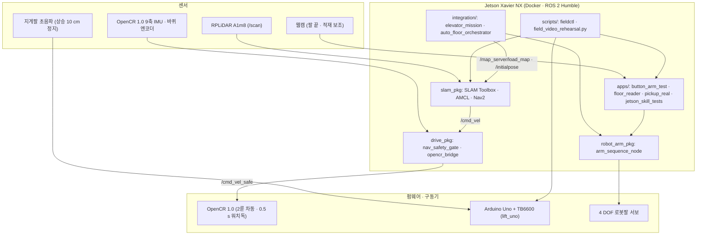
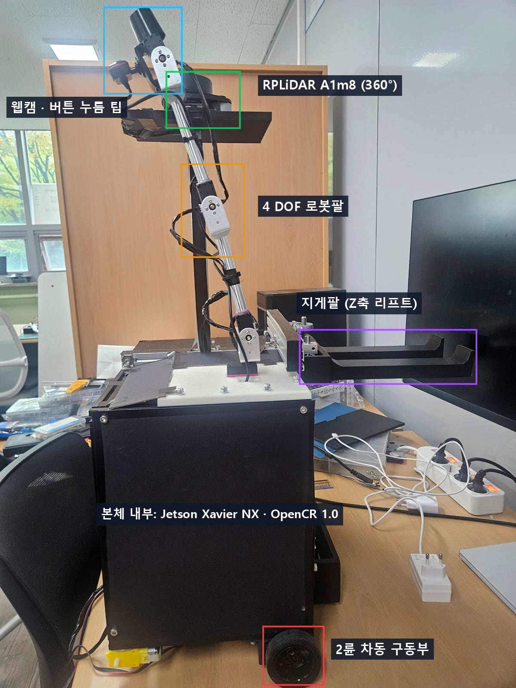
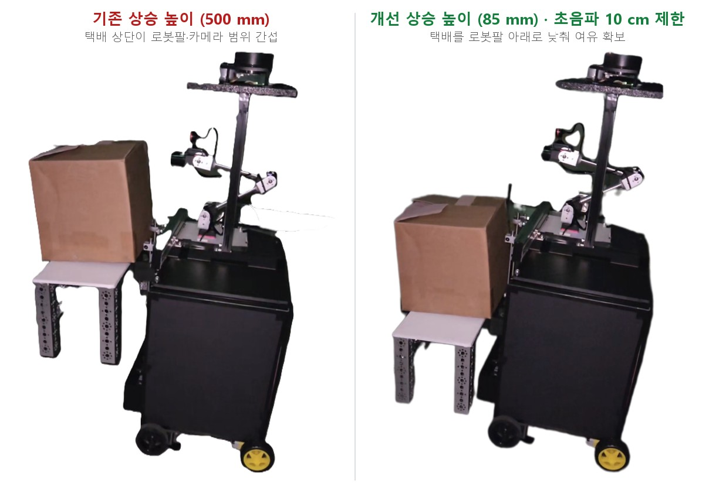
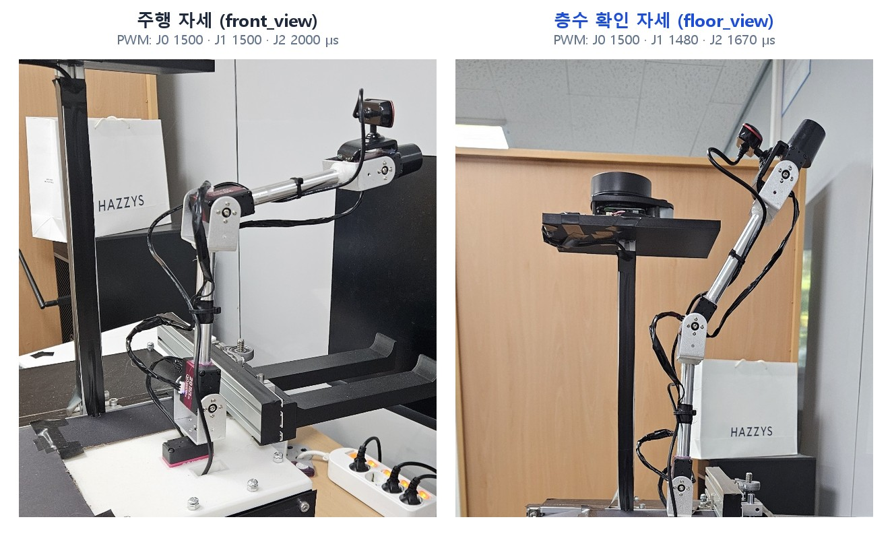

# 시스템 구성

PackagU의 하드웨어 배치와 ROS 2 노드 연결 구조를 적었다. 기구 치수와 실측 여부는 [hardware_spec.md](hardware_spec.md)를 따른다.

## 소프트웨어 및 하드웨어 연결

## 하드웨어 사양 요약

*실물 사진 (2026-10 촬영)*

| 부품 | 사양 | 관련 경로 |
|---|---|---|
| 주 컴퓨터 | NVIDIA Jetson Xavier NX (JetPack 위 Docker ROS 2 Humble) | [`docker/Dockerfile.jetson`](../docker/Dockerfile.jetson), [`docker/compose/docker-compose.jetson.yml`](../docker/compose/docker-compose.jetson.yml) |
| 구동 MCU | OpenCR 1.0 (2륜 차동, 바퀴 간격 0.51324 m, 지름 0.066 m, 9축 IMU) | [`firmware/opencr/`](../firmware/opencr/), [`firmware/opencr_imu/`](../firmware/opencr_imu/), [`src/drive_pkg/`](../src/drive_pkg/) |
| Z축 지게팔 | TB6600 + Arduino Uno (`u`/`d` 12,800펄스, 상승 중 초음파 10 cm 정지) | [`firmware/lift_uno/`](../firmware/lift_uno/), [`scripts/lift_uno_adapter.py`](../scripts/lift_uno_adapter.py) |
| 4 DOF 로봇팔 | 리치 60 cm 서보 팔 + 팔 끝 웹캠 | [`src/robot_arm_pkg/`](../src/robot_arm_pkg/), [`apps/button_arm_test/`](../apps/button_arm_test/) |
| LiDAR | RPLiDAR A1m8 (실내 유효 8 m) | [`src/slam_pkg/`](../src/slam_pkg/) |

## 패키지별 역할

| 경로 | 역할 | 주요 파일 |
|---|---|---|
| `src/common_pkg/` | 로봇 URDF와 가상 건물 월드 원본 설정 | `urdf/delivery_robot.urdf.xacro`, `config/kku_pre_simulation_map.yaml` |
| `src/drive_pkg/` | OpenCR 시리얼 브리지, 오도메트리, 속도 안전 게이트 | `drive_pkg/opencr_protocol.py`, `opencr_bridge.py`, `nav_safety_gate.py` |
| `src/slam_pkg/` | SLAM Toolbox · AMCL · Nav2 launch, 신공학관 실측 지도 | `launch/field_base.launch.py`, `kku_navigation.launch.py`, `config/nav2_params.yaml` |
| `src/robot_arm_pkg/` | 4 DOF 팔 PWM 프로토콜과 시퀀스 노드 | `robot_arm_pkg/servo_protocol.py`, `arm_sequence_node.py`, `config/camera_views.json` |
| `integration/` | 루트와 분리 빌드하는 미션 · 층 전환 overlay 3종 | `elevator_mission/`, `elevator_auto_map_switch/`, `gazebo_world_swap/` |
| `apps/` | 버튼 인식 웹/API, 층수 판독, 팔레트 집기, 공용 상태머신 | `button_arm_test/app.py`, `floor_reader/app.py`, `pickup_real/pickup_real.py`, `jetson_skill_tests/` |
| `scripts/` | 현장 CLI, 26단계 E2E 진행기, 이식성 · 계약 테스트 | `fieldctl`, `field_video_rehearsal.py`, `check_portability.py`, `run_offline_tests.sh` |
| `firmware/` | MCU 펌웨어 스케치 | `opencr/opencr_drive_bridge.ino`, `opencr_imu/`, `lift_uno/lift_uno.ino` |
| `sim/real_maps/` | 신공학관 실측 지도 Gazebo 시뮬 코드와 결과 요약 | `sim_stack.py`, `run_e2e.py`, `opencr_shim.py`, `results/20261008_summary.md` |

## 주요 설계 구조

Nav2의 속도 명령 `/cmd_vel`은 `nav_safety_gate`를 통과한다. `/scan`이나 `/odom`이 끊기면 노드가 `/cmd_vel_safe`를 0으로 내린다. OpenCR 펌웨어는 호스트 명령이 0.5 s 이상 오지 않으면 모터를 세우고 바퀴 속도를 48 rpm 아래로 제한한다([02_opencr_serial_protocol.md](deployment/02_opencr_serial_protocol.md)).

지게팔은 상승 중 정면 초음파 센서(`firmware/lift_uno/lift_uno.ino`)로 320펄스마다 박스 윗면 거리를 확인해 10 cm 미만이면 상승을 멈춘다. 택배가 로봇팔과 카메라 범위를 가리지 않도록 상승 높이를 기존 500 mm에서 85 mm 수준으로 줄이는 개선안을 적용했다.

엘리베이터 탑승 직후에는 로봇팔을 주행 자세(`front_view`: J0 1500 · J1 1500 · J2 2000 µs)에서 층수 확인 자세(`floor_view`: J0 1500 · J1 1480 · J2 1670 µs, [`camera_views.json`](../src/robot_arm_pkg/config/camera_views.json))로 올린다. [`apps/floor_reader/app.py`](../apps/floor_reader/app.py)는 웹캠 ROI를 Otsu 이진화한 뒤 7-segment 템플릿과 IoU 매칭(`>= 0.70`, 마진 `>= 0.08`)으로 현재 층을 판정한다. 1.5 s 창 내 10프레임 중 8프레임 이상 목표층이 유지되면 `TARGET_FLOOR_DETECTED` 이벤트를 발행한다. 실제 하차 판정 스크립트(`scripts/floor_arrival_probe.py`)는 현재 영상 5회 연속 일치를 확인한다.

엘리베이터 층 전환 뒤에는 `ros_map_switch.py`와 `auto_floor_orchestrator_pkg`가 `/map_server/load_map`과 `/initialpose`를 순서대로 부른다. 두 모듈은 새 지도 크기와 원점이 costmap에 들어왔는지 확인한 뒤 다음 주행 목표를 보낸다.

`apps/jetson_skill_tests/skilltests/`의 자율 상태머신은 현장과 시뮬레이션이 같은 코드를 쓴다. 실제 로봇에서는 `ros_adapters.py`를 연결하고 Gazebo에서는 `sim/real_maps/sim_adapters.py`로 바꾼다. 현장 운영 절차는 [08_elevator_camera_mission.md](deployment/08_elevator_camera_mission.md)와 [09_field_video_rehearsal.md](deployment/09_field_video_rehearsal.md)에 적었다.
