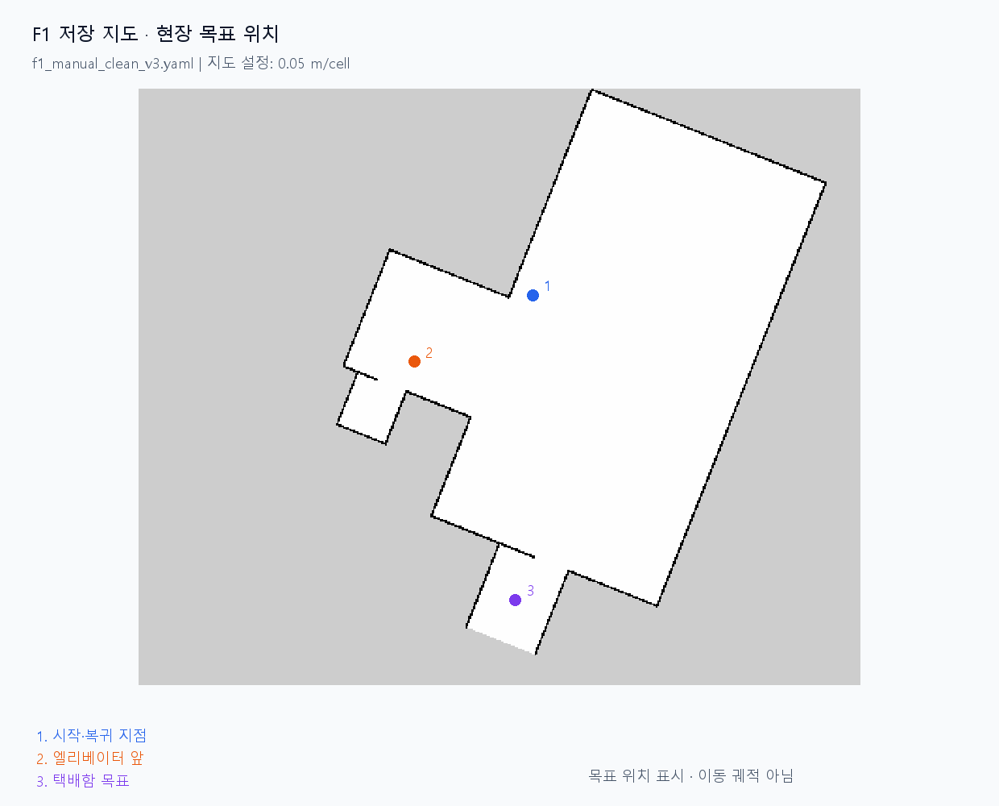
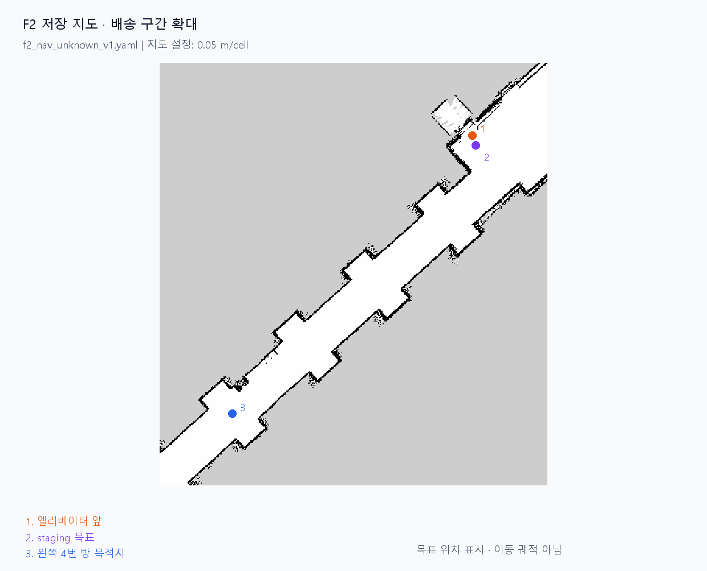

# 검증 결과와 한계

기준 커밋 `Final_Demo@db73e09`(2026-11-04)의 CSV와 보고서에서 뽑은 수치다. 실물 시험과 시뮬레이션 기록을 나눠 적었다.

## 1. 실물 시험

| 대상 | 환경 · 날짜 | 결과 | 판정 | 근거 |
|---|---|---|---|---|
| 신공학관 복도 Nav2 주행 | Jetson Xavier NX + RPLiDAR A1m8 + OpenCR 1.0, F1 · F2 (2026-09-16) | 5회 중 2회 성공(F2 엘리베이터 앞 → 4번 방 244.1 s, F1 엘리베이터 앞 → 출발점 119.2 s). 3회 실패(F1 출발점 → 택배함 96.9 s, F2 목적지 → 엘리베이터 staging 49.4 s · 171.2 s) | 실물 검증 (부분 성공) | `Final_Demo@db73e09` `goal_results.csv` |
| 지게팔 `lift_uno` 펌웨어 대조 | Jetson 연결 Arduino Uno 실물 보드 (2026-10-29) | 플래시 덤프와 소스 일치(부팅 배너 5줄, 출력 문자열 13개, 펄스 10/302 µs, 12,800회, 초음파 10 cm 정지). 진행기 연동 주행은 미실행 | 실물 검증 (보드 대조) | [09_field_video_rehearsal.md](deployment/09_field_video_rehearsal.md) §11 |
| 신공학관 실물 배달 시연 | 건물 복도 · 엘리베이터 실물 | 20초 편집본에서 1층 복도 주행 → 택배 적재 → 호출 버튼 인식 · 누르기 → 엘리베이터 탑승 · 4번 버튼 인식 · 누르기 → 목적층 하차 · 택배 내려놓기 확인. 촬영일 · 구간별 자율/수동 경계 · F1 복귀 구간은 영상만으로 미확인 | 실물 검증 (하이라이트) | [`media/e2e_demo.gif`](media/e2e_demo.gif) |
| 층수 표시기 인식 (`floor_reader`) | 웹캠 + 노트북 테스트 화면 | 목표 4층 이진화 · 템플릿 매칭 일치 점수 `0.79` 확인. 실제 승강기 내부 연속 하차 연동은 미검증 | 오프라인 · 단품 확인 | [`media/floor_reader_ui.jpg`](media/floor_reader_ui.jpg), [`apps/floor_reader/`](../apps/floor_reader/README.md) |

*실측 지도 · 신공학관 1층(F1)*

*실측 지도 · 신공학관 상위층(F2 지도)*

## 2. 시뮬레이션 검증

시뮬레이션은 가상 물리 모델과 일부 가정 치수(`world_params.yaml`)를 썼다. 실물 성공을 보장하지 않는다.

| 대상 | 환경 · 날짜 | 결과 | 판정 | 근거 |
|---|---|---|---|---|
| 가상 건물(KKU) 왕복 + 보행자 5 + 정적 장애물 2 | 데스크톱 Gazebo Classic + ROS 2 Humble (2026-08-21) | 10/10 연속 통과(재시도 0, REALIGN 0, 1회 278~348 s). 정지 드리프트 0.0000 m / 90 s | 시뮬레이션 검증 | 2026-08-21 인수인계 기록 |
| 분산 E2E 부하 시험 (PC Gazebo + Jetson 스택) | 동일 LAN 분산 구성 (2026-08-21) | 3/3 통과(각 11 goal 1차 성공). Jetson CPU 평균 48% · 피크 89~94%, RAM 피크 2.5 / 6.8 GB, `missed_rate` 23~29 | 시뮬레이션 검증 | [01_portability_policy.md](deployment/01_portability_policy.md) §4.5 |
| 신공학관 실측 지도 사전 시험 (G1 · G2 · G3) | 격리 Gazebo + 인코더 odom (2026-10-08) | 5개 조합 19/19 통과(collision-ahead 0, recovery 0, 48 rpm 차단 0) | 시뮬레이션 검증 | [`sim/real_maps/results/20261008_summary.md`](../sim/real_maps/results/20261008_summary.md) |
| 신공학관 실측 지도 왕복 E2E (V5 캐스터 모델) | 격리 Gazebo + 층 전환 + 팔 · 리프트 mock (2026-10-08) | 캐빈 direct 4/4 완주(팔 · 리프트 포함 1회, 시뮬 967.6~1002.0 s). 전 구간 nav2 1/3 완주(2회 `F2_board` 실패). 좁은 문 벽 여유 0.069~0.082 m(기준 0.15 m 미달). 층 전환 AMCL 재정위 12/12 수렴(4.3~8.4 s, 오차 0.029~0.090 m) | 시뮬레이션 검증 | [`sim/real_maps/results/20261008_summary.md`](../sim/real_maps/results/20261008_summary.md) |
| 독립 자동 택배 집기 (2면 ArUco 지그) | 격리 Gazebo + 몸체 카메라 · 초음파 (2026-10-29) | 4개 스위트 18/18 통과(validation 12/12, repeat 4/4, gui 1/1, config_replay 1/1). 기하 판정 attach 기준 | 시뮬레이션 검증 | [`sim/real_maps/pickup/results/20261029.json`](../sim/real_maps/pickup/results/20261029.json) |
| 강의실 v3 배치도 시뮬레이션 | 격리 Gazebo + 레이캐스트 4,112회 (2026-11-04) | 라이다 위치 추정 최대 오차 0.12 cm · 0.051°, 일반 Gazebo 12/12, 적재 거친 조건 7/9(2회 팔레트-벽 접촉), 짐 폭 가림 경계 31~32 cm(31 cm 2/2, 32 cm 0/2), 고정 테이프 복귀 제안 300/300(최대 2.02 cm · 0.78°) | 시뮬레이션 검증 | `Final_Demo@db73e09` v3 보고서 · `runs.csv` |

## 3. 공개 정리 시 직접 수행한 검사 (2026-11-19)

| 검사 항목 | 결과 | 판정 | 비고 |
|---|---|---|---|
| Python 전체 구문 검사 (`py_compile`) | `.py` 264개 오류 0건 | 오프라인 검증 | 호스트 Python 3.12 |
| 공개 안전 · 링크 · 이력 감사 | 커밋 트리 및 전체 이력 `FAIL 0` | 오프라인 검증 | 비밀값 · 사설 IP · 옛 경로 · `Co-Authored-By` 0건 |
| Docker 오프라인 테스트 · `colcon build` · 실기 구동 | 미실행 | 미확인 | 정적 아카이브 정리 범위에서 제외 |

## 4. 남은 한계와 피드백 개선

시뮬레이션은 로봇팔 접촉력, 택배 무게와 마찰, 실제 엘리베이터 문 열림 시간(시뮬 60 s 가정, 실물 5~10 s)을 그대로 옮기지 못했다.

지게팔 펌웨어 `lift_uno`에는 리밋 스위치와 절대 위치 센서가 없다. 시연 피드백에서 지적된 택배-로봇팔 간섭을 줄이려고 상승 중 초음파 10 cm 정지와 상승 높이 축소(500 mm → 85 mm) 방안을 마련했다([`media/lift_height_compare.jpg`](media/lift_height_compare.jpg)). 다만 통신이 끊기면 운영자가 포크 높이를 눈으로 확인해야 한다.

중간층 오하차 위험을 줄이려고 탑승 후 로봇팔을 `floor_view` 자세로 올려 층수 표시기를 읽는 구조([`apps/floor_reader/`](../apps/floor_reader/README.md))를 추가했다. 실제 승강기 내부 조명 반사 조건에서의 연속 하차 연동은 추가 실물 검증이 필요하다.

화물이 LiDAR 스캔면(0.67~0.75 m) 위로 올라오면 전방 스캔이 가려진다. 강의실 v3 시뮬레이션에서는 짐 폭 32 cm 이상일 때 첫 적재 구간 벽 맞춤이 멈췄다.
